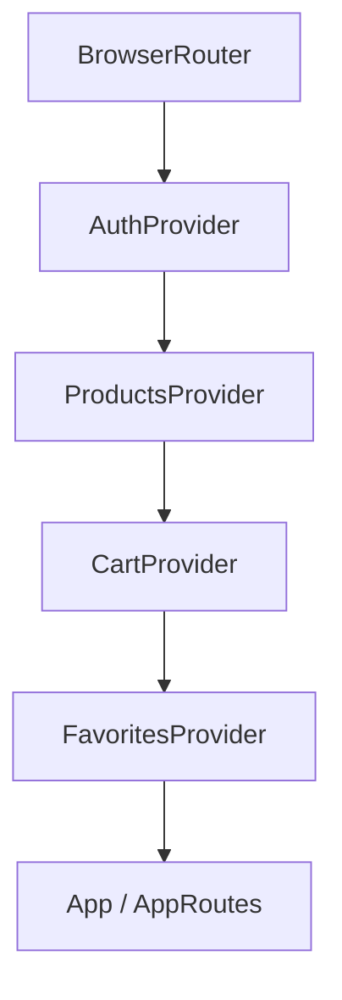
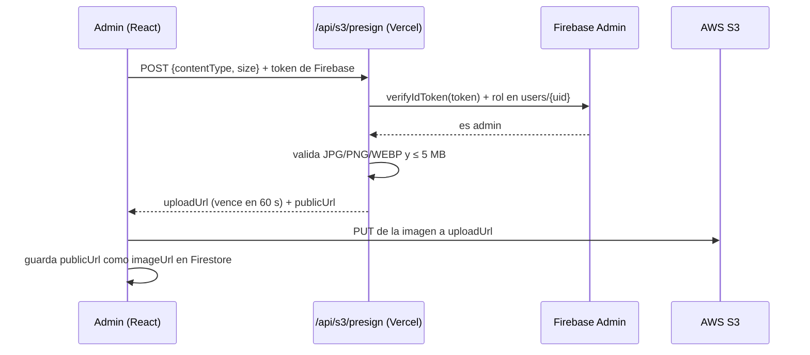

# 💍 M Lady · E-commerce de bisutería

SPA de e-commerce hecha con **React + TypeScript + Vite**, con **Firebase** (Authentication + Firestore) como backend, **AWS S3** para las imágenes y **Vercel** para el deploy y las funciones serverless.

## 🔗 Producción

**https://ecommerce-pt35-kappa.vercel.app**

---

## 📌 Descripción y contexto del cliente

**M Lady** es una marca de bisutería (collares, pulseras y anillos) que necesitaba pasar de vender por mensajes a tener una **tienda online propia**, con un **panel para administrar** el catálogo y los pedidos sin depender de un programador.

Los requisitos del cliente fueron:
- Que los clientes puedan **navegar el catálogo, filtrar, buscar, guardar favoritos, comprar** y ver el **historial de sus pedidos**.
- Que la dueña (administradora) pueda **crear, editar y borrar productos con sus fotos**, y **gestionar el estado de los pedidos**.
- **Costos bajos** y **sin servidores propios que mantener**: por eso se eligieron servicios administrados (Firebase, AWS S3, Vercel).
- **Seguridad**: que un cliente no pueda ver pedidos ajenos ni modificar productos, y que las credenciales nunca queden expuestas.

### Tipos de usuario

| Rol | Puede |
|---|---|
| **Cliente** (`customer`) | Registrarse (email o Google), ver catálogo y detalle, filtrar y buscar, favoritos, carrito, checkout, historial y detalle de sus órdenes |
| **Administrador** (`admin`) | Todo lo anterior + panel propio: CRUD de productos con subida de imágenes a S3, ver/filtrar/cambiar estado de órdenes, gestionar roles de usuarios |

### Funcionalidades

| Área | Qué incluye |
|---|---|
| 🔐 Autenticación | Email/contraseña y Google · login/logout · persistencia de sesión · roles |
| 🗒️ Catálogo | Productos desde Firestore · filtro por categoría · búsqueda con *debounce* · paginación · detalle de producto |
| 🛒 Carrito | Agregar, quitar, cambiar cantidad · total automático · Context API + `useReducer` · un carrito por usuario |
| 👩🏽‍💻 Checkout | Envío a domicilio (localidad) o retiro · pago simulado · orden en Firestore con `serverTimestamp()` · anti doble submit |
| 📦 Órdenes | Estados `pending` · `processing` · `completed` · `cancelled` · historial · detalle con *snapshot* |
| 🈺 Admin | Layout propio · rutas protegidas por rol · CRUD de productos · upload a S3 · filtro y cambio de estado de órdenes |
| ⚙️ UI | Spinner de carga · mensajes de vacío y de error · validación de formularios en tiempo real · responsive |

---

## 🧠 Decisiones arquitectónicas

### ¿Por qué Context API + `useReducer`?

- **Context API** evita el *prop drilling*: el usuario, el carrito y los favoritos se usan en muchas pantallas (Header, tarjetas, carrito, checkout). Cada tema tiene **su propio context** y un **custom hook con guard** (`useCart`, `useAuth`…), que tira un error claro si se usa fuera de su Provider.
- **`useReducer`** en el carrito porque hay **varias acciones sobre el mismo estado** (`ADD_ITEM`, `REMOVE_ITEM`, `UPDATE_QUANTITY`, `CLEAR_CART`). El reducer **centraliza las reglas de negocio** (no superar el stock, recalcular el total) en una **función pura**, fácil de leer y de testear. Las acciones están tipadas con una **unión discriminada** de TypeScript.
- Para el tamaño del proyecto **no hace falta Redux**: Context + `useReducer` vienen con React.
- **Orden de los providers:** `Auth → Products → Cart → Favorites`. El carrito y los favoritos van debajo de Auth porque usan `useAuth()` para guardar datos **por usuario** (`mlady-cart:<uid>`).



### ¿Por qué S3 para las imágenes?

- **Firestore no está pensado para archivos**: tiene un límite de **1 MB por documento** y cobra por lectura. En Firestore se guarda **solo la URL** (`imageUrl`).
- **S3** es barato, escalable y entrega cada imagen por una **URL pública**.
- Con **presigned URLs**, la imagen viaja **directo del navegador a S3**, sin pasar por nuestro servidor: más rápido y sin límites de tamaño de las serverless functions.
- Las **credenciales de AWS solo viven en el backend** (Vercel Function), nunca en el frontend.

### Estructura de carpetas (por capas)

```
ecommerce-pt35/
├── api/
│   └── s3/presign.ts       → Serverless Function: valida admin y firma la URL de S3
├── public/images/          → Archivos estáticos
├── src/
│   ├── types/              → Contratos: Product, CartItem, Order, User
│   ├── services/           → Único lugar que habla con Firebase y con /api
│   ├── contexts/           → Estado global: auth, products, cart, favorites
│   ├── hooks/              → Lógica reutilizable (useOrder)
│   ├── components/         → Piezas visuales reutilizables (Header, Spinner, OrderSummary…)
│   ├── pages/              → Una pantalla por ruta (orders/, admin/)
│   ├── routes/             → AppRoutes, ProtectedRoute, AdminRoute
│   ├── utils/              → Funciones puras: formatPrice, getShippingCost
│   └── test/               → Wrapper de providers, fixtures y setup de tests
├── firestore.rules         → Reglas de seguridad de Firestore
├── .env.example            → Variables necesarias (sin valores reales)
└── vercel.json             → Rewrites de la SPA
```

**Regla de oro:** las páginas y componentes **nunca** hablan directo con Firestore o AWS; siempre pasan por un **service**. Si mañana cambiamos de base de datos, solo se toca `services/`.

### Otras decisiones

- **Snapshot en las órdenes:** cada ítem guarda una copia del producto (nombre, precio, foto) al comprar. Si el precio cambia, la orden sigue mostrando lo que se pagó.
- **`serverTimestamp()`:** la fecha la pone el servidor; la regla exige `createdAt == request.time`.
- **Doble submit:** candado con `useRef` (cambia al instante) además de deshabilitar el botón.
- **Desvíos del stack sugerido:** se usó **React 19** (versión estable al crear el proyecto, compatible con todo lo pedido) y **CSS propio por componente** en lugar de Tailwind, para tener control fino de la identidad visual de la marca.

---

## ⚙️ Instalación y configuración paso a paso

### 1. Clonar e instalar

```bash
git clone https://github.com/MartinaFerreyra/ecommerce-pt35.git
cd ecommerce-pt35
npm install
npm install -g vercel        # CLI de Vercel (para correr las funciones en local)
```

### 2. Firebase

1. Crear un proyecto en [Firebase Console](https://console.firebase.google.com).
2. **Authentication →** habilitar **Correo/contraseña** y **Google**.
3. **Firestore Database →** crear la base.
4. **Reglas →** pegar el contenido de [`firestore.rules`](./firestore.rules) y **Publicar**.
5. **Índices →** crear el índice compuesto `orders`: `userId` ↑ · `createdAt` ↓ (o usar el link que muestra la consola la primera vez que se abre *Mis pedidos*).
6. **Configuración del proyecto → General →** copiar la config web para las variables `VITE_FIREBASE_*`.
7. **Configuración del proyecto → Cuentas de servicio → Generar nueva clave privada →** de ese JSON salen `FIREBASE_PROJECT_ID`, `FIREBASE_CLIENT_EMAIL` y `FIREBASE_PRIVATE_KEY`.
8. **Primer admin:** registrarse en la app y en Firestore → `users/{uid}` cambiar `role` a `"admin"`.

### 3. AWS S3

1. Crear un bucket de **uso general** en `us-east-1`, destildando *Bloquear todo el acceso público*.
2. **Permisos → CORS:**
   ```json
   [{
     "AllowedHeaders": ["*"],
     "AllowedMethods": ["PUT", "GET"],
     "AllowedOrigins": ["http://localhost:3000", "https://ecommerce-pt35-*.vercel.app"],
     "ExposeHeaders": ["ETag"]
   }]
   ```
3. **Permisos → Política del bucket** (lectura pública de las imágenes):
   ```json
   {
     "Version": "2012-10-17",
     "Statement": [{
       "Sid": "PublicReadImages",
       "Effect": "Allow",
       "Principal": "*",
       "Action": "s3:GetObject",
       "Resource": "arn:aws:s3:::NOMBRE-DEL-BUCKET/*"
     }]
   }
   ```
4. **IAM →** crear un usuario con permiso de S3 y generar sus **Access Keys** (*Aplicación ejecutada fuera de AWS*).

### 4. Variables de entorno

```bash
cp .env.example .env
```

Completar `.env` con los valores de los pasos 2 y 3 (ver tabla abajo).

### 5. Correr el proyecto

| Comando | Qué hace |
|---|---|
| `vercel dev` | **Recomendado.** Frontend + funciones de `api/` en `http://localhost:3000` |
| `npm run dev` | Solo el frontend (Vite) en `http://localhost:5173`. La subida de imágenes **no** funciona porque no existe `/api` |
| `npm test` | Corre los tests (Vitest) |
| `npm run build` | Build de producción |

### 6. Deploy en Vercel

1. Importar el repositorio de GitHub en [Vercel](https://vercel.com) (integración continua: cada `git push` a `main` despliega).
2. **Settings → Environment Variables →** cargar **todas** las variables del `.env`.
3. **Deployments → Redeploy** después de cambiar variables.

---

## 🔑 Variables de entorno

El archivo [`.env.example`](./.env.example) está en el repo **sin valores reales**. `.env` está en `.gitignore`.

| Variable | Dónde se usa | ¿Secreta? |
|---|---|---|
| `VITE_FIREBASE_API_KEY` | Navegador | No (la protegen las Firestore Rules) |
| `VITE_FIREBASE_AUTH_DOMAIN` | Navegador | No |
| `VITE_FIREBASE_PROJECT_ID` | Navegador | No |
| `VITE_FIREBASE_STORAGE_BUCKET` | Navegador | No |
| `VITE_FIREBASE_MESSAGING_SENDER_ID` | Navegador | No |
| `VITE_FIREBASE_APP_ID` | Navegador | No |
| `S3_REGION` | Serverless Function | No |
| `S3_BUCKET` | Serverless Function | No |
| `S3_ACCESS_KEY_ID` | Serverless Function | **Sí** |
| `S3_SECRET_ACCESS_KEY` | Serverless Function | **Sí** |
| `FIREBASE_PROJECT_ID` | Serverless Function | No |
| `FIREBASE_CLIENT_EMAIL` | Serverless Function | **Sí** |
| `FIREBASE_PRIVATE_KEY` | Serverless Function | **Sí** |

> Las variables **con `VITE_`** se incluyen en el código del navegador. Las secretas **no llevan `VITE_`**: solo las lee la función de Vercel y **nunca llegan al frontend**.

---

## 🖼️ Flujo de upload de imágenes a S3 con presigned URLs



1. El admin elige una foto en el formulario del producto.
2. `uploadService` pide permiso a `/api/s3/presign` enviando su **token de Firebase**.
3. La función verifica el token con **Firebase Admin** y que el rol sea `admin`.
4. Valida el **tipo** (JPG, PNG, WEBP) y el **tamaño** (máx. 5 MB).
5. Firma una URL para **un solo archivo** (`products/<uuid>.<ext>`) que **vence en 60 segundos**.
6. El navegador sube la imagen **directo a S3** con un `PUT`.
7. La URL pública se guarda como `imageUrl` del producto en Firestore.

| Respuesta | Cuándo |
|---|---|
| `405` | Método distinto de POST |
| `401` | Sin token o token inválido |
| `403` | El usuario no es admin |
| `400` | Tipo o tamaño no permitido |
| `200` | `{ uploadUrl, publicUrl }` |

---

## 🔏 Seguridad: Firestore Rules

En [`firestore.rules`](./firestore.rules), probadas en el **simulador de reglas** de Firebase.

| Colección | Lectura | Escritura |
|---|---|---|
| `products` | Pública | Solo admin |
| `users` | El propio usuario o un admin | Al registrarse solo como `customer`; nadie puede cambiarse el rol |
| `orders` | Su dueño o un admin | Crear: la propia, en `pending`, con fecha del servidor y total consistente · Actualizar: solo admin y solo `status`/`updatedAt` · Borrar: nunca |

---

## ✅ Testing

`npm test` → **40 tests en 7 archivos**, sin depender de servicios externos.

| Archivo | Qué prueba |
|---|---|
| `src/test/renderWithProviders.tsx` | **Wrapper de providers** (Router + Auth + Cart + Favorites) |
| `cartReducer.test.ts` | Cada acción del reducer + casos edge |
| `useCart.test.tsx` | `useCart` con `renderHook`: guard, acciones, total, persistencia |
| `useAuth.test.tsx` | `useAuth` con `renderHook` y **Firebase mockeado** |
| `cartAuth.integration.test.tsx` | Cada usuario tiene su propio carrito |
| `checkout.integration.test.tsx` | **Flujo completo**: agregar al carrito → checkout → orden creada |
| `uploadService.test.ts` | Subida con Firebase Auth y `fetch` mockeados |
| `presign.test.ts` | Serverless Function con **AWS SDK y Firebase Admin mockeados** |

---

## 🤖 Bitácora de uso de IA

Usé IA (**Claude**) como tutora y revisora durante todo el desarrollo: no solo para escribir código, sino para **entender conceptos, comparar alternativas, revisar mi código y diagnosticar errores reales**. Cada fila es un momento clave del proyecto.

| # | Tema | Situación / problema | Cómo usé la IA | Qué aprendí y qué decidí |
|---|---|---|---|---|
| 1 | 🗺️ **Planificación** | Tenía los productos y el carrito en `App.tsx` y pasaba props por varios niveles. | Le pedí que me explicara Context API con una analogía y que propusiera cómo organizar el proyecto si iba a crecer. | Entendí el *prop drilling*. Decidí separar en capas (`types → services → contexts → pages`), un context por tema con su hook y guard, y el orden de providers según dependencias (el carrito depende de Auth). |
| 2 | 🔍 **Code review** | Mi carrito tenía la lógica repartida en varias funciones con `useState`. | Le pedí que revisara el código y me explicara cuándo conviene `useReducer`. | Pasé a un reducer con acciones tipadas como unión discriminada. La revisión me marcó que el total debía **recalcularse** (no guardarse aparte) y que `ADD_ITEM` no debía superar el stock. |
| 3 | ⚖️ **Validación de decisión técnica** | No sabía si guardar las imágenes en Firestore o en otro lado, ni cómo proteger las claves de AWS. | Le pedí comparar Firestore vs S3 y explicar las presigned URLs. | Elegí S3 (Firestore tiene 1 MB por documento). Aprendí la diferencia entre variables `VITE_` (públicas) y secretas, y que las claves de AWS solo pueden vivir en la Serverless Function. |
| 4 | 🛠️ **Resolución de problemas** | En Vercel la función daba `500 FUNCTION_INVOCATION_FAILED`, pero en local funcionaba. | Le pasé los **Runtime Logs** de Vercel para interpretarlos. | Aprendí a leer los logs del servidor. Eran dos errores: `ERR_MODULE_NOT_FOUND` (había subido una versión vieja que importaba `api/_lib`) y `ERR_REQUIRE_ESM` (`firebase-admin` v14 incompatible con el runtime). Decidí unificar la función en un archivo y bajar a `firebase-admin@13`. |
| 5 | 🛠️ **Resolución de problemas** | La subida a S3 fallaba con `blocked by CORS policy` solo desde algunas URLs de Vercel. | Le pedí que me explicara el error y el *preflight*. | Entendí que CORS es una protección del navegador y que cada deploy de Vercel tiene su URL. Agregué `https://ecommerce-pt35-*.vercel.app` a los orígenes permitidos del bucket. |
| 6 | 🔐 **Validación de seguridad** | Las credenciales de AWS y de Firebase Admin quedaron expuestas al pegarlas en un chat. | Le consulté qué riesgo implicaba y cómo resolverlo. | Aprendí que una clave expuesta debe considerarse comprometida: **roté** las claves (nueva clave de Firebase Admin y nuevas Access Keys en mi propio bucket) y las cargué solo en `.env` y en Vercel. Desde entonces no comparto secretos. |
| 7 | ⚖️ **Validación de decisión técnica** | Tenía que escribir las Firestore Rules de órdenes y tomé como base un ejemplo del profesor. | Le pedí revisar las reglas contra mi app. | Detectó que `users: allow write: if false` rompía el registro y el cambio de roles de mi app, así que lo adapté. Sumé `createdAt == request.time` (obliga a usar `serverTimestamp`), `hasOnly(["status","updatedAt"])` y validación del total. Las probé en el simulador. |
| 8 | 🛠️ **Resolución de problemas** | *Mis pedidos* mostraba "No se pudieron cargar" aunque las órdenes existían. | Le pasé el error de la consola. | Aprendí que `where` + `orderBy` sobre campos distintos requiere un **índice compuesto** en Firestore. Lo creé y el error desapareció. |
| 9 | 🧪 **Generación de tests** | La consigna pedía tests de reducer, hooks, integración y mocks de Firebase y AWS. | Le pedí generar casos de test y **casos edge** que yo no había considerado. | Sumó casos como stock límite, cantidad 0, acción desconocida, doble click en el checkout, 401/403/400 en la función y error de Firestore. Aprendí a usar `renderHook`, `vi.mock` y `vi.hoisted`. |
| 10 | 🔍 **Code review / debugging de tests** | Dos tests fallaban con "Found multiple elements" y después `localStorage is not defined`. | Le pasé la salida de `vitest`. | Entendí que Testing Library limpia sola el DOM solo con `globals` activado, así que agregué un `setup.ts` con `cleanup()`. Y que el test de la función corre en entorno `node`, donde no existe `localStorage`. Resultado: **40/40 tests**. |

**Conclusión:** la IA me sirvió para **aprender el porqué** de cada decisión (Context, reducer, S3, reglas de seguridad) y para **diagnosticar errores reales** leyendo logs y mensajes, no solo para copiar código. Cada sugerencia la probé, la adapté a mi proyecto y la validé con tests y en producción.

---

## 📝 Convención de commits

`feat:` nueva funcionalidad · `fix:` corrección · `test:` tests · `docs:` documentación · `refactor:` cambios internos.
